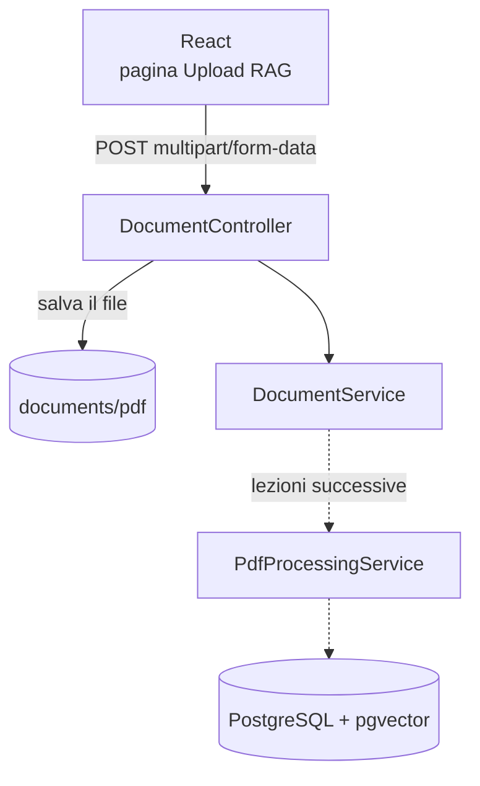

# Lezione 1 – Caricare un PDF dal frontend

> [!abstract] In breve
> Costruiamo la "porta d'ingresso" del sistema RAG: una pagina React che invia un PDF al backend, e un controller Spring Boot che lo riceve, lo salva su disco e risponde con un resoconto.
> Leggere il PDF e indicizzarlo nel database **non** fa parte di questa lezione: arriva in [[02-lettura-e-chunking-pdf]].

> [!info] Aggiornamento
> Dalla [[03b-indicizzazione-asincrona|lezione 3.1]] l'upload risponde subito con `202 Accepted` e l'indicizzazione prosegue in background: i PDF grandi andavano in timeout.

## 1. Il flusso completo



Le frecce tratteggiate sono i passi che implementeremo nelle prossime lezioni.

| File | Ruolo |
|---|---|
| `dto/DocumentUploadResponse.java` | La "busta" con cui rispondiamo al frontend |
| `controller/DocumentController.java` | Riceve il file, lo valida e lo salva |
| `service/DocumentService.java` | **Provvisorio**: per ora registra solo il file ricevuto |
| `frontend/src/pages/UploadRag.jsx` | La pagina React con l'upload |
| `application.properties` | Limite di dimensione dei file |

## 2. Il DTO di risposta

Un **DTO** (Data Transfer Object) è un oggetto che serve solo a trasportare dati. Con i `record` di Java si scrive in poche righe:

```java
public record DocumentUploadResponse(
    String filename,
    int pages,
    int chunks,
    String message
) {}
```

Spring lo trasforma automaticamente in JSON:

```json
{
  "filename": "manuale.pdf",
  "pages": 0,
  "chunks": 0,
  "message": "PDF salvato correttamente. L'indicizzazione verrà implementata nelle prossime lezioni."
}
```

> [!note] Perché `pages` e `chunks` valgono 0?
> Perché ancora non leggiamo il PDF. Questi campi si riempiranno da soli nelle prossime lezioni, senza cambiare il frontend.

## 3. Il controller

### `FilePart` o `MultipartFile`?

La lezione originale usa `FilePart`, la classe di **Spring WebFlux** per i file. Nel nostro progetto però il `pom.xml` contiene **sia** `spring-boot-starter-webmvc` **sia** `spring-boot-starter-webflux`.

> [!important] Regola di Spring Boot
> Se trova entrambi gli starter, Spring Boot avvia l'applicazione in modalità **Spring MVC** (server Tomcat classico). In MVC un file caricato arriva come **`MultipartFile`**. `FilePart` funzionerebbe solo convertendo tutta l'applicazione a WebFlux.

Abbiamo quindi scelto `MultipartFile`. Il concetto non cambia: è solo la classe che rappresenta il file.

| | Spring MVC | Spring WebFlux |
|---|---|---|
| Classe del file | `MultipartFile` | `FilePart` |
| Salvataggio | `file.transferTo(path)` (bloccante) | `file.transferTo(path)` restituisce un `Mono<Void>` |
| Server | Tomcat (un thread per richiesta) | Netty (pochi thread, non bloccanti) |

### Il codice passo per passo

```java
@PostMapping(consumes = MediaType.MULTIPART_FORM_DATA_VALUE)
public Mono<DocumentUploadResponse> uploadPdf(
        @RequestPart("file") MultipartFile file
) throws IOException {
```

1. **`@RequestPart("file")`** prende dalla richiesta la parte chiamata `file`. È lo stesso nome usato in React con `formData.append("file", file)`.
2. **Validazione**: il file non deve essere vuoto e deve finire con `.pdf`. Se qualcosa non va lanciamo una `IllegalArgumentException`.
3. **Nome univoco**: salviamo il file come `UUID.pdf`, per esempio `550e8400-e29b-41d4-a716-446655440000.pdf`.
4. **Salvataggio**: `Files.createDirectories(...)` crea la cartella se manca, `file.transferTo(...)` scrive il PDF.
5. **Indicizzazione**: chiamiamo `documentService.indexPdf(...)` dentro un `Mono` su `Schedulers.boundedElastic()`.

> [!warning] Sicurezza: mai usare il nome originale come percorso
> Un utente malintenzionato potrebbe caricare un file chiamato `../../application.properties.pdf`. Se usassimo quel nome per costruire il percorso, il file potrebbe finire **fuori** dalla cartella prevista (attacco *path traversal*). Con l'UUID il nome lo decidiamo noi. Il nome originale lo conserviamo solo come informazione da mostrare.

### Perché `Mono` e `boundedElastic` anche in MVC?

Spring MVC accetta anche i tipi reattivi come valore di ritorno. Con `Schedulers.boundedElastic()` spostiamo il lavoro pesante su un pool di thread pensato per operazioni **bloccanti**. Nelle prossime lezioni il lavoro pesante sarà leggere il PDF, generare gli embedding e scrivere nel database.

```java
return Mono.fromCallable(() -> documentService.indexPdf(destination, storedFilename, originalFilename))
           .subscribeOn(Schedulers.boundedElastic());
```

Oggi `indexPdf` fa pochissimo, ma la struttura è già pronta per quando diventerà lenta.

### Errori leggibili dal frontend

```java
@ExceptionHandler(IllegalArgumentException.class)
public ResponseEntity<Map<String, String>> handleInvalidFile(IllegalArgumentException ex) {
    return ResponseEntity.status(HttpStatus.BAD_REQUEST)
                         .body(Map.of("message", ex.getMessage()));
}
```

Senza questo metodo un file sbagliato produrrebbe un generico errore **500**. Con il metodo il frontend riceve un **400** con un messaggio chiaro: `{"message": "Caricare un file PDF"}`.

### CORS

```java
@CrossOrigin(origins = "http://localhost:5173")
```

React gira sulla porta **5173** e Spring Boot sulla **8081**: per il browser sono due "siti" diversi. Senza questa annotazione il browser bloccherebbe la risposta.

## 4. Il limite di dimensione

```properties
spring.servlet.multipart.max-file-size=100MB
spring.servlet.multipart.max-request-size=100MB
```

- `max-file-size`: dimensione massima di **un singolo file**
- `max-request-size`: dimensione massima di **tutta la richiesta** (file e altri campi insieme)

> [!warning] Tienili allineati
> Se imposti `max-file-size=50MB` ma lasci `max-request-size=20MB`, un PDF da 30 MB viene comunque rifiutato: conta sempre il limite più basso.

> [!tip] Lo sapevi?
> In Spring MVC il limite predefinito è **1 MB**: quasi ogni manuale PDF lo supererebbe. Oltre il limite, Spring risponde con **413 Payload Too Large**.

## 5. Il service provvisorio

Il controller ha bisogno di un `DocumentService` per compilare, ma la versione completa arriva più avanti nel corso. Per ora ne usiamo una "segnaposto" che registra il file nei log e restituisce la risposta:

```java
public DocumentUploadResponse indexPdf(Path pdfPath, String storedFilename, String originalFilename) {
    log.info("PDF ricevuto: " + originalFilename + " salvato come: " + storedFilename);
    return new DocumentUploadResponse(originalFilename, 0, 0, "PDF salvato correttamente...");
}
```

Questa tecnica si chiama **stub**: un'implementazione minima che rispetta il "contratto" (nome del metodo, parametri, tipo di ritorno) e che sostituiremo con quella vera.

## 6. Il frontend React

La nuova voce di menu **"Upload file per sistema RAG"** (`/upload-rag`) apre la pagina `UploadRag.jsx`.

La funzione centrale è quella della lezione, con una gestione degli errori più completa:

```js
async function uploadPdf(file) {
  const formData = new FormData();
  formData.append('file', file); // "file" = @RequestPart("file")

  const response = await fetch('http://localhost:8081/api/documents', {
    method: 'POST',
    body: formData, // niente Content-Type: lo imposta il browser con il "boundary"
  });

  const data = await response.json().catch(() => null);
  if (!response.ok) throw new Error(data?.message || 'Errore durante il caricamento');
  return data;
}
```

> [!note] Perché non impostiamo `Content-Type`?
> Con `FormData` il browser scrive da solo `multipart/form-data; boundary=----XYZ`. Il *boundary* è il separatore tra le parti della richiesta. Se lo scrivessimo a mano dimenticheremmo il boundary e il backend non riuscirebbe a leggere il file.

Cosa offre la pagina:
- **Trascina e rilascia** oppure clic per scegliere il file
- **Controlli lato client**: solo PDF e massimo 100 MB (la costante `MAX_FILE_SIZE_MB` va tenuta uguale al valore del backend), così l'errore appare prima di inviare il file
- **Resoconto dell'upload** (l'esercitazione della lezione): nome, dimensione, pagine, chunk, durata e orario
- **Storico degli upload** della sessione
- Badge **"Solo Admin"**: per ora è solo visivo, perché il gestionale non ha ancora il login. La vera protezione arriverà con l'autenticazione (per esempio con Spring Security e i ruoli).

## 7. Come provarlo

1. Avvia i container: `docker compose -f docker/docker-compose.yml up -d`
2. Avvia Spring Boot (porta 8081) e React (`cd frontend && npm run dev`)
3. Apri `http://localhost:5173/upload-rag` e carica un PDF
4. Controlla la cartella `documents/pdf/`: troverai il file rinominato con un UUID

Oppure da terminale, senza frontend:

```bash
curl -F "file=@manuale.pdf" http://localhost:8081/api/documents
```

| Prova | Risultato atteso |
|---|---|
| PDF valido | `200` + JSON di resoconto |
| File `.txt` | `400` + `{"message":"Caricare un file PDF"}` |
| PDF da 101 MB | `413 Payload Too Large` |

> [!warning] Dove finisce il file?
> `documents/pdf` è un percorso **relativo**: dipende dalla cartella da cui avvii Spring Boot. Con la configurazione di VS Code del progetto è la root del repository, quindi `gestionale-spring-rag/documents/pdf`. I PDF caricati sono esclusi da git tramite `.gitignore`.

## 8. Verso la produzione

Cose che qui abbiamo semplificato e che in un'app reale servono:
- controllare il **contenuto** del file (i primi byte di un PDF sono `%PDF`), non solo l'estensione
- proteggere l'endpoint con **autenticazione e ruoli**
- un `@RestControllerAdvice` per gestire gli errori di tutta l'app in un unico punto
- uno spazio di archiviazione esterno (S3, MinIO) al posto del disco locale

## Domande di ripasso

1. Perché in questo progetto usiamo `MultipartFile` e non `FilePart`?
2. Cosa succederebbe se salvassimo il file con il suo nome originale?
3. Perché nel `fetch` non scriviamo l'header `Content-Type`?
4. Cosa risponde Spring se carichi un file più grande del limite?

---
Prossima lezione: [[02-lettura-e-chunking-pdf]]
