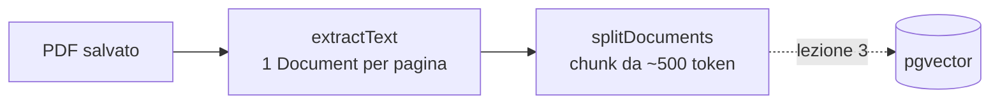

# Lezione 2 – Leggere un PDF e dividerlo in chunk

> [!abstract] In breve
> Nella [[01-upload-pdf-dal-frontend|lezione 1]] il PDF arrivava sul server e veniva solo salvato. Ora lo **leggiamo** pagina per pagina e lo **dividiamo in chunk**, cioè blocchi di testo piccoli. Sono i "mattoncini" che nella [[03-embedding-e-ricerca-semantica|lezione 3]] trasformeremo in vettori.

## 1. Dove siamo nel flusso



| File | Novità |
|---|---|
| `service/PdfProcessingService.java` | **Nuovo**: lettura del PDF e chunking |
| `service/DocumentService.java` | Ora chiama `extractText()` e `splitDocuments()` e restituisce i numeri veri di pagine e chunk |

Il frontend non cambia: i campi `pages` e `chunks` della risposta, che prima valevano 0, ora contengono i valori reali.

## 2. Che cos'è un `Document`?

In Spring AI un `Document` è una scatola con due cose dentro:

```text
Document
 ├── text      → "Spring Boot è un framework Java..."
 └── metadata  → { page_number=1, source=..., original_filename=... }
```

- **Testo**: è il contenuto che cercheremo.
- **Metadati**: sono le informazioni *sul* testo, per esempio da quale file e da quale pagina arriva. Servono per citare la fonte di una risposta.

## 3. Estrarre il testo con `PagePdfDocumentReader`

`PagePdfDocumentReader` usa **Apache PDFBox** per leggere il PDF e produce un `Document` per ogni pagina.

```java
PdfDocumentReaderConfig config = PdfDocumentReaderConfig.builder()
        .withPagesPerDocument(1)   // 1 Document = 1 pagina
        .build();

PagePdfDocumentReader reader = new PagePdfDocumentReader(
        new FileSystemResource(pdfPath),  // il file è su disco, non nel classpath
        config
);

List<Document> pages = reader.read();
```

> [!question] Perché `FileSystemResource` e non `ClassPathResource`?
> `ClassPathResource` legge i file **dentro** l'applicazione (`src/main/resources`), che vengono impacchettati nel jar. I nostri PDF invece arrivano a runtime nella cartella `documents/pdf`, quindi li leggiamo dal **file system**.

### Aggiungere i nostri metadati

```java
Map<String, Object> metadata = new HashMap<>(page.getMetadata()); // copia modificabile
metadata.put("source", storedFilename);              // es. 80a54232-....pdf
metadata.put("original_filename", originalFilename); // es. manuale.pdf
result.add(new Document(page.getText(), metadata));
```

Creiamo una **copia** con `new HashMap<>(...)` per non modificare la mappa originale del reader, che potrebbe anche essere immutabile.

> [!note] Pagine senza testo
> Abbiamo aggiunto un piccolo controllo che salta le pagine con testo vuoto. Nel test abbiamo visto che il reader scarta già da solo le pagine completamente bianche: il nostro controllo è una sicurezza in più. Se un PDF non ha **nessuna** pagina con testo, `DocumentService` risponde `400 – Il PDF non contiene testo leggibile`.

> [!warning] PDF scansionati
> Se il PDF è una scansione (solo immagini) il reader non trova testo. In questo caso serve un **OCR**, per esempio Tesseract.

## 4. Cosa abbiamo visto in console (test reale)

Abbiamo caricato un PDF di prova di 4 pagine: 3 con testo e 1 bianca. Ecco l'output reale, accorciato:

```text
==============================
PAGINA: 1
==============================
Introduzione   a  Spring  Boot
...
METADATI:
{page_number=1, file_name=80a54232-9ada-4095-a6e7-f25b6faa2147.pdf}
```

> [!important] Sorpresa: i metadati non sono quelli che ci aspettavamo
> La lezione originale mostrava `start_page_number` e `end_page_number`. Con `withPagesPerDocument(1)` invece Spring AI 2.0.1 scrive:
> - `page_number` → numero della pagina
> - `file_name` → nome del file letto
>
> `start_page_number`/`end_page_number` compaiono solo quando un Document contiene **più pagine** (`withPagesPerDocument(2)` o superiore).
>
> Ecco perché **stampiamo i metadati invece di presumerli**. Nella prossima lezione, quando costruiremo il contesto per l'LLM e scriveremo le query SQL, useremo `page_number`.

> [!tip] Osservazione: spazi in eccesso
> Il testo estratto contiene spazi multipli (`Introduzione   a  Spring  Boot`). PDFBox cerca di riprodurre la **posizione** delle parole nella pagina. Non è un errore, ma quegli spazi consumano token. Per ripulirli Spring AI offre `ExtractedTextFormatter`, da passare con `withPageExtractedTextFormatter(...)`. È un buon esercizio di ottimizzazione.

## 5. Perché dividere il testo in chunk?

Immagina un manuale di 300 pagine. Mandarlo tutto all'LLM a ogni domanda significherebbe:

- tanti **token** consumati, quindi **costi** alti
- più **latenza**
- il rischio di superare la **finestra di contesto** del modello
- risposte **meno precise**, perché l'informazione utile si perde nel resto

Con il chunking dividiamo il testo in pezzi piccoli. Ogni pezzo diventa un elemento indipendente del Vector Store, e a ogni domanda recupereremo **solo i chunk pertinenti**.

## 6. `TokenTextSplitter`

```java
TokenTextSplitter splitter = TokenTextSplitter.builder()
        .withChunkSize(500)            // ~500 token per chunk
        .withMinChunkSizeChars(200)    // cerca di non tagliare prima di 200 caratteri
        .withMinChunkLengthToEmbed(20) // scarta i chunk più corti di 20 caratteri
        .withMaxNumChunks(10000)       // tetto massimo di chunk
        .withKeepSeparator(true)       // conserva gli a capo
        .build();

List<Document> chunks = splitter.apply(documents);
```

| Parametro | Significato |
|---|---|
| `chunkSize` | Dimensione target di un chunk, in **token** |
| `minChunkSizeChars` | Numero minimo di caratteri prima di cercare un punto in cui tagliare (fine frase) |
| `minChunkLengthToEmbed` | I chunk più corti di questo valore vengono scartati |
| `maxNumChunks` | Numero massimo di chunk generati |
| `keepSeparator` | Mantiene i separatori, cioè gli a capo |

> [!question] Cos'è un token?
> Un token è un pezzo di parola. In media, in italiano, 1 token corrisponde a circa 3-4 caratteri. "Configurazione" può diventare 3 token. I modelli ragionano in token, quindi misuriamo i chunk in token e non in caratteri.

> [!note] Valori didattici
> 500, 200, 20 e 10.000 sono punti di partenza, non valori universali: si calibrano guardando i risultati della ricerca. In Spring AI 2.0.x **non** esiste ancora `withChunkOverlap()`, cioè la sovrapposizione tra chunk vicini. È arrivata con la 2.1.0-RC1.

### Il risultato del test

```text
Pagine con testo: 3
Chunk generati: 4
```

| Chunk | Pagina | `chunk_index` |
|---|---|---|
| 1 | 1 | 0 |
| 2 | 1 | 1 |
| 3 | 2 | 0 |
| 4 | 3 | 0 |

La pagina 1 era più lunga di 500 token (anche per via degli spazi in eccesso), quindi è stata divisa in **due** chunk.

Ogni chunk **eredita i metadati** della sua pagina, e Spring AI ne aggiunge altri due:

```text
{chunk_index=1, page_number=1, original_filename=manuale-spring.pdf,
 file_name=80a54232-....pdf, source=80a54232-....pdf,
 parent_document_id=f198a8e7-...}
```

- `chunk_index`: posizione del chunk all'interno della sua pagina
- `parent_document_id`: id del Document (la pagina) da cui è nato

> [!important] Perché è fondamentale
> Quando la ricerca semantica restituirà un chunk, sapremo **da quale PDF e da quale pagina** proviene. È così che l'assistente potrà citare le fonti.

## 7. Le stampe temporanee

In `extractText()` e `splitDocuments()` abbiamo aggiunto dei `System.out.println` racchiusi tra commenti `TEMPORANEO`. Servono solo a scopo didattico, per vedere cosa succede. In un'applicazione reale si usa un **logger** (`log.debug(...)`), che si può accendere e spegnere dalla configurazione.

## 8. Come provarlo

1. Avvia Spring Boot e React come nella [[01-upload-pdf-dal-frontend|lezione 1]]
2. Apri `http://localhost:5173/upload-rag` e carica un PDF con del testo
3. Guarda la **console di Spring Boot**: vedrai le pagine, poi i chunk, ognuno con i suoi metadati
4. Nel resoconto della pagina React, "Pagine" e "Chunk" ora hanno valori reali

| Prova | Risultato atteso |
|---|---|
| PDF con testo | `200`, `pages` > 0, `chunks` > 0 |
| PDF con sole pagine bianche o scansioni | `400 – Il PDF non contiene testo leggibile` |

## Domande di ripasso

1. Che differenza c'è tra il testo e i metadati di un `Document`?
2. Perché usiamo `FileSystemResource`?
3. Quale chiave contiene il numero di pagina con `withPagesPerDocument(1)`? E perché la lezione suggeriva di stampare i metadati?
4. Perché un manuale intero non va mandato all'LLM a ogni domanda?
5. Cosa succede ai metadati quando una pagina viene divisa in più chunk?

---
Lezione precedente: [[01-upload-pdf-dal-frontend]] · Prossima lezione: [[03-embedding-e-ricerca-semantica]]
