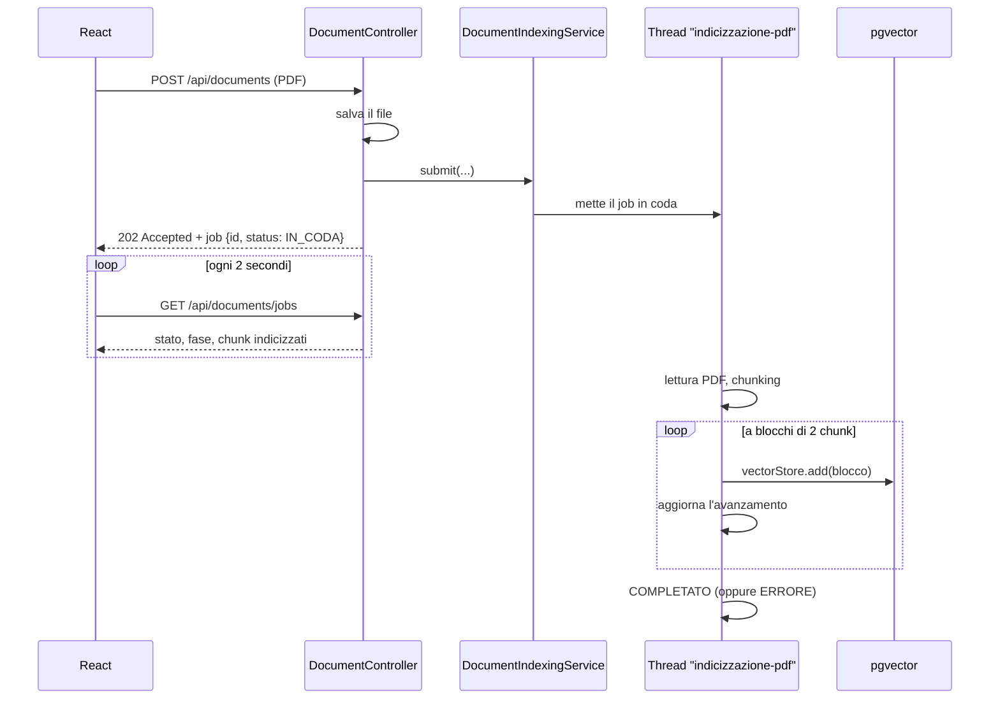

# Lezione 3.1 – Indicizzazione asincrona: quando l'upload va in timeout

> [!abstract] In breve
> Caricando un PDF di 25 pagine la richiesta andava in **timeout**. Abbiamo trovato la causa misurando, e risolto cambiando architettura: l'upload ora **risponde subito**, l'indicizzazione prosegue **in background**, e la pagina React **chiede periodicamente lo stato** (polling) mostrando una barra di avanzamento.

## 1. Il sintomo

```text
WARN ... DefaultHandlerExceptionResolver : Resolved [AsyncRequestTimeoutException]
```

`AsyncRequestTimeoutException` significa che una richiesta **asincrona** (il nostro `Mono` restituito dal controller) non è terminata entro il tempo massimo: `spring.mvc.async.request-timeout=120s`.

## 2. L'indagine: misurare prima di cambiare

> [!tip] Metodo
> Prima di modificare il codice si scopre **dove** va il tempo, misurando un pezzo alla volta.

| Domanda | Come l'abbiamo verificato | Risposta |
|---|---|---|
| Il timeout attivo era quello giusto? | `grep async target/classes/application.properties` | Sì, 120 s |
| Il file è arrivato al server? | `ls documents/pdf` | Sì, 41 MB salvati in pochi secondi |
| Cosa faceva il backend? | `docker logs chatbot-ollama` | Un'unica chiamata `/api/embed` durata **1 min 50 s**, interrotta allo scadere dei 120 s |
| Quanti chunk produce il PDF? | Un piccolo programma Java con lo **stesso** reader e splitter, senza embedding | **25 pagine → 41 chunk**, letti e divisi in **2 secondi** |
| Quanto costa un chunk? | Chiamata diretta a Ollama con un testo di circa 370 token | **circa 23 secondi** a chunk |

Conclusione: **41 chunk × ~23 s ≈ 16 minuti**, contro un timeout di 2 minuti.

> [!info] Perché Ollama è così lento qui?
> Su macOS i container Docker **non possono usare la GPU** del Mac (Metal). Ollama in Docker gira solo sulla CPU, e con un modello come `bge-m3` su testi lunghi impiega decine di secondi per ogni chunk. Su Mac Ollama installato nativamente, o un servizio di embedding esterno, sarebbe molto più veloce. Per scelta del corso **restiamo su Docker**, quindi la soluzione deve funzionare anche con embedding lenti.

## 3. Due problemi diversi

1. **Velocità** degli embedding: dipende dall'ambiente, e qui l'abbiamo accettata.
2. **Architettura**: l'upload aspettava la fine dell'indicizzazione **dentro la stessa richiesta HTTP**. Anche con embedding veloci, un PDF da 300 pagine prima o poi andrebbe in timeout.

Alzare il timeout a 30 minuti avrebbe solo **spostato** il problema: pagina bloccata senza feedback, e prima o poi un PDF più grande del limite. La soluzione corretta è separare l'**upload** dall'**elaborazione**.

## 4. La nuova architettura



| File | Ruolo |
|---|---|
| `model/IndexingStatus.java` | Gli stati: `IN_CODA`, `IN_ELABORAZIONE`, `COMPLETATO`, `ERRORE` |
| `model/IndexingJob.java` | Lo stato di un'indicizzazione, aggiornato mentre lavora |
| `dto/IndexingJobResponse.java` | La "fotografia" del job inviata al frontend |
| `service/DocumentIndexingService.java` | **Nuovo**: coda, thread dedicato, elenco dei job |
| `service/DocumentService.java` | Aggiorna le fasi, salva a blocchi, pulisce se fallisce |
| `controller/DocumentController.java` | `POST` → **202**; nuovi `GET /jobs` e `GET /jobs/{id}` |
| `frontend/src/pages/UploadRag.jsx` | Polling, barra di avanzamento, stima del tempo |

## 5. `202 Accepted`: "ho ricevuto, ci sto lavorando"

```java
IndexingJobResponse job = documentIndexingService.submit(destination, storedFilename, originalFilename);
return ResponseEntity.status(HttpStatus.ACCEPTED).body(job);
```

| Codice | Significato |
|---|---|
| `200 OK` | Ecco il risultato |
| `201 Created` | Ho creato la risorsa |
| **`202 Accepted`** | Ho accettato la richiesta, ma **il lavoro non è ancora finito** |

Risultato misurato: l'upload risponde in **0,03 secondi**, invece di restare in attesa per minuti.

## 6. Il thread dedicato

```java
private final ExecutorService executor = Executors.newSingleThreadExecutor(
        runnable -> new Thread(runnable, "indicizzazione-pdf")
);

executor.submit(() -> runJob(job, pdfPath, storedFilename, originalFilename));
```

- **Un solo thread**: i PDF si indicizzano uno alla volta, in ordine di arrivo. Il collo di bottiglia è Ollama, quindi due PDF in parallelo si contenderebbero la stessa CPU senza finire prima. Gli altri aspettano **in coda** (`IN_CODA`).
- **Un nome al thread** (`indicizzazione-pdf`): nei log si vede subito chi sta lavorando.
- **`@PreDestroy` → `shutdownNow()`**: quando l'app si spegne, o devtools la riavvia, fermiamo il thread invece di lasciarlo orfano.

> [!question] Perché non `@Bean ThreadPoolTaskExecutor`?
> Spring Boot crea già un executor suo (`applicationTaskExecutor`), che altre parti dell'applicazione usano. Registrare un nostro bean di tipo `Executor` può far sì che Boot **non crei più il suo**: un effetto collaterale difficile da notare. Tenere l'executor **dentro** il service evita il problema.

> [!warning] Perché non `Mono` + `boundedElastic` come prima?
> Con `Mono` la richiesta HTTP resta aperta finché il lavoro non finisce: è proprio quello che causava il timeout. Inoltre, allo scadere del timeout Spring **cancella** il `Mono` e interrompe il thread: l'indicizzazione si fermava a metà. Ora la richiesta e il lavoro hanno **vite separate**.

## 7. Thread diversi, stesso oggetto: `synchronized`

L'`IndexingJob` viene **scritto** dal thread di indicizzazione e **letto** dai thread HTTP del polling.

```java
public synchronized void addIndexedChunks(int count) { this.chunksIndexed += count; }

public synchronized IndexingJobResponse toResponse() { return new IndexingJobResponse(...); }
```

`synchronized` fa entrare un thread alla volta, così il frontend non legge mai uno stato a metà (per esempio `status=COMPLETATO` con `chunksIndexed` non ancora aggiornato). I job sono in una `ConcurrentHashMap`, una mappa pensata per l'accesso da più thread.

Al frontend mandiamo un **record** (`IndexingJobResponse`): una copia immutabile, scattata dentro il blocco sincronizzato.

## 8. Salvare a blocchi e ripulire in caso di errore

```java
for (int start = 0; start < chunks.size(); start += batchSize) {
    List<Document> batch = chunks.subList(start, Math.min(start + batchSize, chunks.size()));
    vectorStore.add(batch);                     // embedding + INSERT di 2 chunk
    batch.forEach(c -> savedIds.add(c.getId()));
    job.addIndexedChunks(batch.size());         // avanzamento visibile al frontend
}
```

```properties
app.documents.indexing-batch-size=2
```

- **Blocchi piccoli** significano un avanzamento più frequente: con Ollama lento, circa ogni 45 secondi.
- Se un blocco fallisce a metà documento, **cancelliamo i chunk già salvati**:

```java
} catch (RuntimeException ex) {
    if (!savedIds.isEmpty()) vectorStore.delete(savedIds);
    throw ex;
}
```

Meglio **nessun** chunk che un documento indicizzato **a metà**: l'assistente risponderebbe con informazioni incomplete senza saperlo.

> [!example] Come abbiamo testato la pulizia
> Abbiamo messo tra il backend e Ollama un piccolo **proxy di test** in Python, che inoltra la prima richiesta di embedding e alla seconda risponde `500`:
> ```text
> POST /api/embed  200   ← blocco 1: 2 chunk salvati
> POST /api/embed  500   ← blocco 2: guasto simulato
> Backend: "rimuovo 2 chunk parziali"
> Righe del PDF nel database: 0
> ```
> È la tecnica della **fault injection**: si provoca apposta un guasto per verificare che il codice lo gestisca.

## 9. Il frontend: polling

```js
const hasActiveJobs = jobs.some(job => ['IN_CODA', 'IN_ELABORAZIONE'].includes(job.status));

useEffect(() => {
  if (!hasActiveJobs) return undefined;
  const intervalId = setInterval(refreshJobs, 2000);  // ogni 2 secondi
  return () => clearInterval(intervalId);              // pulizia!
}, [hasActiveJobs, refreshJobs]);
```

- Il polling parte **solo** se c'è almeno un job attivo e si **ferma da solo** quando tutti sono finiti.
- La funzione di pulizia (`return () => clearInterval(...)`) evita intervalli "fantasma" quando l'utente cambia pagina.
- All'apertura della pagina chiediamo `GET /api/documents/jobs`: se lasci la pagina e poi torni, ritrovi l'avanzamento, perché il lavoro **continua sul server**.
- **Stima del tempo rimanente** = tempo medio per chunk finora × chunk mancanti. È solo una stima: se Ollama rallenta, la stima cresce.

> [!note] Polling o push?
> Il polling è semplice e robusto. In alternativa il server potrebbe *spingere* gli aggiornamenti con **SSE**, come facciamo nella chat, o con WebSocket. Per un aggiornamento ogni 2 secondi il polling basta e avanza.

## 10. Limiti consapevoli

- I job vivono **in memoria**: se riavvii il backend, lo **storico** dei job si perde. I chunk già salvati in pgvector restano. Un job interrotto a metà da un riavvio viene fermato e i suoi chunk parziali vengono rimossi. In produzione i job si salvano su database o si usa una coda (RabbitMQ, Kafka...).
- Con devtools, ogni modifica al codice Java riavvia l'app e interrompe un'indicizzazione in corso.
- La `ConcurrentHashMap` dei job cresce senza limiti: va bene per un progetto didattico, mentre in produzione si cancellano i job vecchi.

## 11. Test eseguiti

| Prova | Risultato |
|---|---|
| Upload di un PDF da 4 chunk | `202` in 0,03 s; avanzamento 0/4 → 2/4 → 4/4; `COMPLETATO` |
| Secondo upload durante il primo | Resta `IN_CODA` e parte quando il primo finisce |
| PDF senza testo | `ERRORE` – "Il PDF non contiene testo leggibile" |
| Guasto di Ollama al secondo blocco (proxy) | `ERRORE`, 2 chunk parziali rimossi, 0 righe nel database |
| Pagina React | Fase, barra di avanzamento, stima del tempo, durata finale; il polling si ferma a fine lavoro |

## Domande di ripasso

1. Che differenza c'è tra `200 OK` e `202 Accepted`?
2. Perché alzare il timeout non era la soluzione giusta?
3. Perché usiamo **un solo** thread di indicizzazione?
4. A cosa serve `synchronized` in `IndexingJob`?
5. Perché cancelliamo i chunk già salvati se l'indicizzazione fallisce a metà?
6. Cosa succede ai job se riavvii il backend?

---
Lezione precedente: [[03-embedding-e-ricerca-semantica]] · Prossimo passo: [[04-passaggio-docker]]
