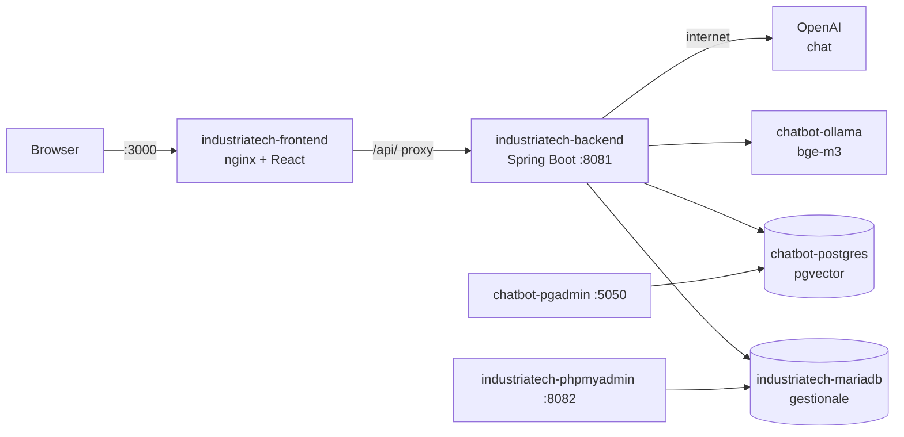

# Lezione 4 – Tutto il progetto in Docker

> [!abstract] In breve
> Prima in Docker c'erano solo i servizi del RAG: PostgreSQL con pgvector, pgAdmin e Ollama. Ora c'è **tutto**: il database MariaDB del gestionale, phpMyAdmin, il **backend Spring Boot** e il **frontend React**, servito da nginx. Con un solo comando si avvia l'intera applicazione.

## 1. La mappa dei container



| Servizio | Container | Indirizzo dal tuo computer |
|---|---|---|
| Frontend | `industriatech-frontend` | http://localhost:3000 |
| Backend | `industriatech-backend` | http://localhost:8090 |
| MariaDB | `industriatech-mariadb` | `localhost:3307` |
| phpMyAdmin | `industriatech-phpmyadmin` | http://localhost:8082 |
| PostgreSQL + pgvector | `chatbot-postgres` | `localhost:5433` |
| pgAdmin | `chatbot-pgadmin` | http://localhost:5050 |
| Ollama | `chatbot-ollama` | http://localhost:11434 |

```bash
cd docker
docker compose up -d --build   # costruisce le immagini e avvia tutto
docker compose ps               # stato dei container
docker compose logs -f backend  # log del backend in tempo reale
docker compose down             # ferma tutto (i dati restano nei volumi)
```

> [!tip] Porte diverse da quelle di sviluppo
> Docker usa **3000** (frontend) e **8090** (backend), mentre lo sviluppo usa **5173** (Vite) e **8081** (VS Code). Così puoi tenere accesi entrambi e confrontarli.

## 2. Prima di Docker: sistemare la build Maven

Per creare l'immagine del backend Docker esegue `mvn package`, **senza VS Code**. Quel comando falliva già prima, anche da terminale:

```text
[WARNING] 'dependencies.dependency.scope' for lombok must be one of [provided, compile, ...] but is 'annotationProcessor'
[ERROR] cannot find symbol: method getNome()
```

Due problemi:
1. `<scope>annotationProcessor</scope>` **non esiste** in Maven. È uno scope di **Gradle**, finito per sbaglio nel `pom.xml`.
2. **Da Java 23** `javac` non attiva più da solo gli annotation processor trovati nel classpath: bisogna dichiararli.

```xml
<dependency>
    <groupId>org.projectlombok</groupId>
    <artifactId>lombok</artifactId>
    <optional>true</optional>
</dependency>
...
<plugin>
    <artifactId>maven-compiler-plugin</artifactId>
    <configuration>
        <annotationProcessorPaths>
            <path>
                <groupId>org.projectlombok</groupId>
                <artifactId>lombok</artifactId>
                <version>${lombok.version}</version>
            </path>
        </annotationProcessorPaths>
    </configuration>
</plugin>
```

> [!question] Perché in VS Code funzionava?
> VS Code non compila con Maven ma con il **proprio** compilatore (quello di Eclipse), che ha già il supporto a Lombok. "Funziona sul mio PC" non vuol dire "funziona ovunque": Docker lo fa notare subito.

## 3. Da MySQL a MariaDB

Il `pom.xml` usava già il driver `mariadb-java-client`: niente driver MySQL da sostituire. Mancava solo il **dialetto** giusto:

```properties
# prima
spring.jpa.properties.hibernate.dialect=org.hibernate.dialect.MySQLDialect
# dopo
spring.jpa.properties.hibernate.dialect=org.hibernate.dialect.MariaDBDialect
```

Il dialetto dice a Hibernate quale "variante" di SQL generare. MariaDB è nato come fork di MySQL ma oggi ha funzionalità proprie (sequence, tipi JSON, ottimizzatore diverso).

> [!note] Nei log
> Hibernate 7 scrive `MariaDBDialect does not need to be specified explicitly`: lo riconosce da solo dalla connessione. Lo lasciamo comunque esplicito per chiarezza didattica.

### Il container MariaDB

```yaml
mariadb:
  image: mariadb:lts
  environment:
    MARIADB_ROOT_PASSWORD: ${MARIADB_ROOT_PASSWORD:-root123}
    MARIADB_DATABASE: industriatech
    MARIADB_USER: ${MARIADB_USER:-industriatech}
    MARIADB_PASSWORD: ${MARIADB_PASSWORD:-industriatech123}
  ports:
    - "3307:3306"
  healthcheck:
    test: ["CMD", "healthcheck.sh", "--connect", "--innodb_initialized"]
```

- Al **primo** avvio l'immagine crea da sola database e utente leggendo le variabili `MARIADB_*`.
- Non usiamo `root` per l'applicazione: creiamo un utente dedicato (`industriatech`).
- `3307:3306` significa *porta del tuo computer : porta del container*. La 3306 del tuo computer era già occupata da un MariaDB installato con Homebrew.
- `${MARIADB_PASSWORD:-industriatech123}` significa: prendi il valore dal file `.env` e, se manca, usa quello dopo `:-`.

### Copiare i dati dal MariaDB locale

```bash
./docker/scripts/importa-dati-mariadb-locale.sh
```

Lo script fa un **dump** del database locale (`mariadb-dump`) e lo importa nel container (`docker exec -i ... mariadb < dump.sql`). Il database locale viene solo **letto**. Risultato: i 3 dipendenti sono stati copiati nel container.

## 4. phpMyAdmin

Apri http://localhost:8082 ed entra con l'utente `industriatech` e la password `industriatech123`.

```yaml
phpmyadmin:
  image: phpmyadmin:latest
  environment:
    PMA_HOST: mariadb    # il NOME DEL SERVIZIO, non "localhost"
```

> [!warning] phpMyAdmin non gestisce PostgreSQL
> phpMyAdmin funziona solo con MySQL e MariaDB. Per PostgreSQL/pgvector resta **pgAdmin** (http://localhost:5050), che ora trova già configurato il server **"Chatbot PostgreSQL"** grazie al file `docker/pgadmin/servers.json`. La password richiesta è `chatbot123`.

## 5. Il concetto chiave: dentro Docker `localhost` non è il tuo computer

Ogni container ha la **sua** rete. Dentro il container del backend, `localhost` è il container stesso, non il tuo Mac. I container si trovano tra loro con il **nome del servizio** del Compose:

| Da VS Code (il tuo computer) | Da dentro Docker |
|---|---|
| `jdbc:mariadb://localhost:3307/industriatech` | `jdbc:mariadb://mariadb:3306/industriatech` |
| `jdbc:postgresql://localhost:5433/chatbot` | `jdbc:postgresql://postgres:5432/chatbot` |
| `http://localhost:11434` (Ollama) | `http://ollama:11434` |

Attenzione: dentro Docker si usa la porta **interna** del container (3306, 5432), non quella pubblicata sul tuo computer (3307, 5433).

### Sovrascrivere `application.properties` con le variabili d'ambiente

Non serve un secondo file di configurazione. Spring Boot legge anche le **variabili d'ambiente**, che vincono su `application.properties`:

```yaml
backend:
  environment:
    SPRING_DATASOURCE_URL: jdbc:mariadb://mariadb:3306/industriatech
    APP_DATASOURCE_PGVECTOR_URL: jdbc:postgresql://postgres:5432/chatbot
    SPRING_AI_OLLAMA_BASE_URL: http://ollama:11434
    APP_DOCUMENTS_DIRECTORY: /app/documents/pdf
    OPENAI_API_KEY: ${OPENAI_API_KEY:-}
```

**Regola (relaxed binding)**: si scrive tutto in maiuscolo, e punti e trattini diventano `_`.
`spring.ai.ollama.base-url` → `SPRING_AI_OLLAMA_BASE_URL`

Così lo **stesso jar** funziona sia in sviluppo sia in Docker.

## 6. L'immagine del backend (multi-stage)

```dockerfile
FROM maven:3.9-eclipse-temurin-25 AS build     # 1) JDK + Maven: compila
COPY pom.xml .
RUN mvn -q -B dependency:go-offline              #    dipendenze in cache
COPY src ./src
RUN mvn -q -B -DskipTests package

FROM eclipse-temurin:25-jre                      # 2) solo JRE: esegue
USER spring                                      #    non come root
COPY --from=build /build/target/*.jar app.jar
ENTRYPOINT ["java", "-XX:MaxRAMPercentage=75", "-jar", "/app/app.jar"]
```

- **Multi-stage**: Maven e il JDK servono solo per compilare. L'immagine finale contiene solo il JRE e il jar, quindi è più piccola e ha meno "superficie d'attacco".
- **Prima il `pom.xml`, poi `src`**: Docker riusa la cache di un passaggio se i suoi file non sono cambiati. Modificando solo il codice Java, le dipendenze (centinaia di MB) **non** vengono riscaricate.
- **`USER spring`**: se qualcuno sfruttasse una vulnerabilità dell'app, non avrebbe i permessi di root nel container.
- **`MaxRAMPercentage=75`**: la JVM si adatta alla memoria del container.
- **devtools** e **Lombok** non finiscono nel jar: il primo è escluso in automatico da Spring Boot, il secondo lo escludiamo noi perché serve solo in compilazione.

## 7. L'immagine del frontend: React + nginx

```dockerfile
FROM node:22-alpine AS build
RUN npm ci
ARG VITE_API_URL=""
RUN npm run build              # crea i file statici in dist/

FROM nginx:alpine
COPY nginx.conf /etc/nginx/conf.d/default.conf
COPY --from=build /app/dist /usr/share/nginx/html
```

In produzione React non ha bisogno di Node: `npm run build` produce HTML, JS e CSS **statici**, che nginx serve in modo molto efficiente.

### Un unico indirizzo per le API: `src/config.js`

Prima l'indirizzo `http://localhost:8081` era scritto in 4 file diversi. Ora è in un solo punto:

```js
export const API_BASE_URL = import.meta.env.VITE_API_URL ?? 'http://localhost:8081';
```

- In sviluppo `VITE_API_URL` non esiste, quindi si usa `http://localhost:8081`.
- In Docker la build riceve `VITE_API_URL=""`, quindi le chiamate diventano relative (`/api/dipendenti`).

> [!warning] Le variabili `VITE_*` si fissano durante la build
> Vite le "incolla" nel JavaScript durante `npm run build`. Per cambiarle bisogna **ricostruire** l'immagine; non basta riavviare il container.

### nginx come reverse proxy

```nginx
location /api/ {
    proxy_pass http://backend:8081;
    proxy_buffering off;          # SSE: i token passano subito
    proxy_read_timeout 300s;
}
client_max_body_size 100m;        # upload dei PDF

location / {
    try_files $uri $uri/ /index.html;   # React Router
}
```

| Riga | Perché |
|---|---|
| `proxy_pass http://backend:8081` | Il browser chiama `localhost:3000/api/...` e nginx inoltra al backend. Frontend e API hanno la **stessa origine**, quindi non serve CORS |
| `proxy_buffering off` | Senza questa riga nginx accumulerebbe la risposta della chat e i token arriverebbero **tutti insieme alla fine** |
| `client_max_body_size 100m` | Il limite predefinito di nginx è **1 MB**: gli upload dei PDF fallirebbero con 413 |
| `try_files ... /index.html` | Aprendo direttamente `/upload-rag` nginx cercherebbe un file che non esiste (404). Restituendo `index.html`, è React Router a mostrare la pagina |

## 8. Ordine di avvio: `depends_on` e healthcheck

```yaml
backend:
  depends_on:
    mariadb:     { condition: service_healthy }
    postgres:    { condition: service_healthy }
    ollama:      { condition: service_healthy }
    ollama-init: { condition: service_completed_successfully }
```

`depends_on` da solo aspetta che il container **parta**, non che il database sia **pronto**. Con `service_healthy` Docker aspetta che l'**healthcheck** dia esito positivo. Senza, Spring Boot potrebbe provare a connettersi a un MariaDB ancora in avvio e fallire.

## 9. Segreti: il file `.env`

```bash
cp docker/.env.example docker/.env   # poi inserisci la tua OPENAI_API_KEY
```

- `docker/.env` è in `.gitignore`: **le chiavi non vanno mai su git**.
- `docker/.env.example` invece è su git, e mostra quali variabili servono, senza valori reali.
- Docker Compose legge da solo il file `.env` della cartella in cui lo lanci. Se la variabile esiste già nella shell (per esempio con `export OPENAI_API_KEY=...`), vince quella.

## 10. Volumi: dove restano i dati

| Volume / cartella | Contenuto |
|---|---|
| `mariadb_data` | Il database del gestionale |
| `postgres_data` | I chunk e i vettori di pgvector |
| `ollama_data` | Il modello `bge-m3` (1,2 GB) |
| `../documents` (bind mount) | I PDF caricati, **condivisi** con lo sviluppo in VS Code |

`docker compose down` **non** cancella i volumi. `docker compose down -v` sì: usalo solo se vuoi davvero ripartire da zero.

> [!danger] Non cambiare il nome del progetto Compose
> I volumi si chiamano `<progetto>_<volume>`, per esempio `docker_postgres_data`. Il progetto prende il nome dalla cartella (`docker`). Rinominando la cartella, o aggiungendo `name:` al file, Docker creerebbe volumi **nuovi e vuoti**: spariresti tutti i chunk indicizzati e il modello andrebbe riscaricato.

## 11. Problemi reali incontrati

> [!bug] Nome del container già in uso
> `Conflict. The container name "/gestionale-mariadb" is already in use`
> Sul computer esisteva già un container con quel nome, creato a mano il 19/10 e fermo. **Non l'abbiamo cancellato**, perché poteva contenere dati. Abbiamo dato ai nostri container il prefisso `industriatech-`.
> `container_name` è comodo ma deve essere **unico su tutto il computer**, non solo nel progetto.

> [!bug] Il backend di VS Code ha smesso di rispondere
> Abbiamo puntato `application.properties` al MariaDB in Docker (porta 3307) prima di avviare il container. devtools ha riavviato l'app, la connessione è fallita e l'app non è ripartita. Soluzione: avviare il container e **riavviare l'app da VS Code**.

> [!example] Avvio del backend in 228 secondi
> Un avvio normale richiede circa 15 secondi. Leggendo i log, **ogni** fase era lenta allo stesso modo, quindi il problema non era un componente preciso. Il Mac aveva lo **swap quasi pieno** (9,3 GB su 10 GB) e un carico medio di **163**. Docker gira in una macchina virtuale con 8 GB riservati: quando il computer è in affanno, ne risente tutto.
> **Consiglio**: prima di una lezione dal vivo chiudi le applicazioni pesanti (videochiamate, molte schede del browser) oppure riduci la memoria assegnata a Docker Desktop.

## 12. Test eseguiti

| Prova | Risultato |
|---|---|
| Build di backend e frontend (`docker compose build`) | Riuscita, circa 5 minuti la prima volta |
| http://localhost:3000 e `/upload-rag` (React Router) | `200` |
| `GET /api/dipendenti` via nginx | I 3 dipendenti copiati dal MariaDB locale |
| Backend diretto su `:8090` | `200` |
| phpMyAdmin `:8082` e pgAdmin `:5050` | `200` |
| Ricerca semantica via nginx | Trovato il chunk corretto |
| Chat in streaming via nginx | **74 pacchetti** separati: lo streaming funziona |
| Upload via nginx | `202` in 0,1 s, file scritto in `documents/pdf` dall'utente non-root, job **COMPLETATO** |

## Domande di ripasso

1. Perché nel container del backend non possiamo usare `localhost:3307` per MariaDB?
2. Come si scrive `app.datasource.pgvector.url` come variabile d'ambiente?
3. Che vantaggio dà la build **multi-stage**?
4. Perché il `COPY pom.xml` viene **prima** del `COPY src`?
5. Cosa succede alla chat se togli `proxy_buffering off`?
6. Perché non bisogna cambiare il nome del progetto Compose?

---
Lezione precedente: [[03b-indicizzazione-asincrona]]
